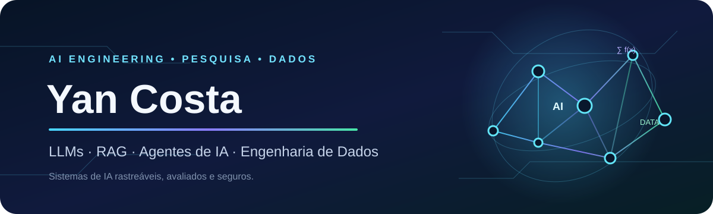
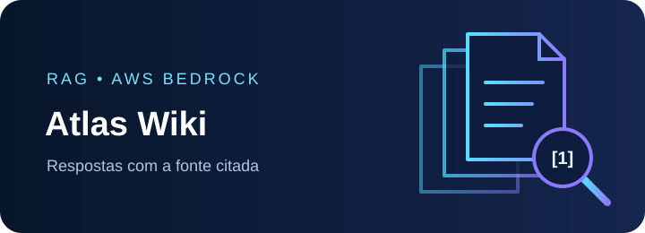
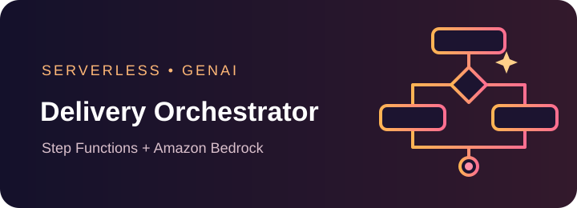
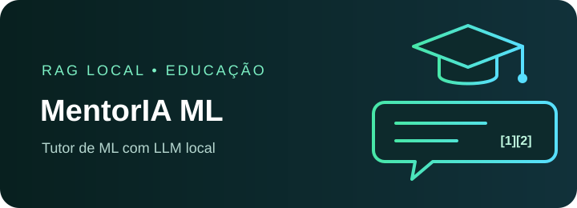
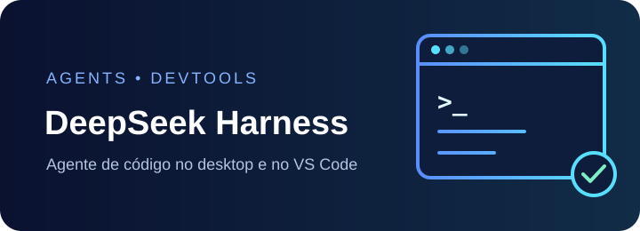
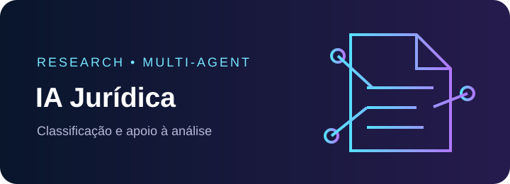
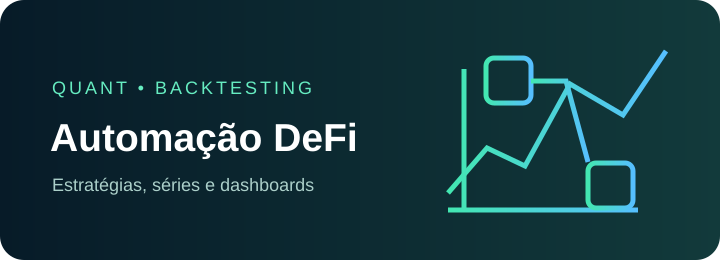
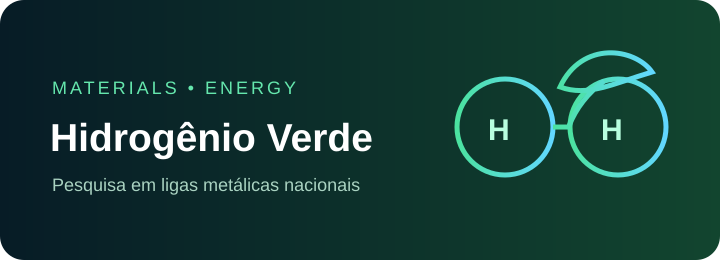

<!--
  README DO PERFIL — YanCarneosso
  Posicionamento: AI Engineer (LLMs, RAG, agentes, avaliação e operação).
  Guia de manutenção: PROFILE_CONFIG.md
  Pendências: ORCID e Lattes (badges comentados abaixo) e coautores das publicações.
-->

  

<h3 align="center">AI Engineer · LLMs · RAG · Agentes de IA · AWS · Engenharia de Dados</h3>

  Construo sistemas de IA generativa orientados à produção: RAG que cita as fontes, agentes com guardrails, 
  avaliação com métricas e infraestrutura serverless. Engenheiro Físico (UNILA) e mestrando em IA (UFLA).

  
  
  <!-- ORCID: descomente e troque o href pela URL pública.
  
  -->
  <!-- LATTES: descomente e troque o href pela URL pública.
  
  -->

  <a href="#sobre">Sobre</a> ·
  <a href="#como-construo-sistemas-de-ia">Abordagem</a> ·
  <a href="#competências">Competências</a> ·
  <a href="#projetos-em-destaque">Projetos</a> ·
  <a href="#pesquisa-e-publicações">Pesquisa e publicações</a> ·
  <a href="#trajetória">Trajetória</a> ·
  <a href="#certificações-e-reconhecimentos">Certificações</a>

## Sobre

Meu foco é **AI Engineering**: levar modelos de linguagem e de machine learning do protótipo a sistemas confiáveis. Nos meus projetos, isso significa respostas fundamentadas em fontes, LLMs operando dentro de contratos e regras determinísticas, avaliação com métricas antes de qualquer conclusão e infraestrutura com testes, CI e decisões documentadas.

Trabalho com **engenharia de dados na GaussFleet**, onde desenvolvo pipelines, integrações, APIs e dashboards com Python, PHP, SQL e Power BI, a base de dados de que todo sistema de IA depende. Participo do **University Mentoring Program (B4U) da Bayer** e, no mestrado na **UFLA**, integro o grupo de pesquisa em Inteligência Artificial e Automação (AIA), onde pesquiso aprendizado de máquina e agentes de IA para apoio a decisões jurídico-administrativas. A formação em Engenharia Física me deu a base em modelagem matemática, métodos numéricos e método experimental que aplico ao avaliar sistemas de IA.

<table>
  <tr>
    <td>🎯 Foco: AI Engineering — LLMs, RAG e agentes</td>
    <td>🎓 Mestrado em IA aplicada — UFLA (previsão: dez. 2027)</td>
  </tr>
  <tr>
    <td>💼 Engenharia de Dados — GaussFleet</td>
    <td>📄 10 trabalhos acadêmicos publicados ou apresentados (2023–2026)</td>
  </tr>
  <tr>
    <td>🌎 Português · Espanhol · Inglês em desenvolvimento</td>
    <td>🏅 2 menções honrosas: pesquisa e extensão</td>
  </tr>
</table>

## Como construo sistemas de IA

| Princípio | Na prática | Onde ver |
|---|---|---|
| **Respostas fundamentadas** | RAG que cita a fonte de cada resposta e se abstém quando não há evidência suficiente | [Atlas](https://github.com/YanCarneosso/aws-intelligent-corporate-wiki) · [MentorIA](https://github.com/YanCarneosso/mentoria-ml) |
| **LLM dentro de limites** | O modelo interpreta linguagem natural; pagamento, idempotência e regras críticas ficam em código determinístico | [Delivery Orchestrator](https://github.com/YanCarneosso/intelligent-delivery-orchestrator) |
| **Avaliação com métricas** | Conjuntos de avaliação para recuperação de fontes e recusas corretas; modelos e thresholds escolhidos por custo de negócio | [MentorIA](https://github.com/YanCarneosso/mentoria-ml) · [Detecção de Fraudes](https://github.com/YanCarneosso/fraud-detection-ml) |
| **Segurança desde o início** | Guardrails, contratos JSON Schema, defesa contra *prompt injection* e modelos de ameaças | [Atlas](https://github.com/YanCarneosso/aws-intelligent-corporate-wiki) · [Delivery Orchestrator](https://github.com/YanCarneosso/intelligent-delivery-orchestrator) |
| **Engenharia para operação** | Infraestrutura como código, CI, observabilidade, ADRs, runbooks e modelos de custo | [Atlas](https://github.com/YanCarneosso/aws-intelligent-corporate-wiki) · [Delivery Orchestrator](https://github.com/YanCarneosso/intelligent-delivery-orchestrator) |

## Competências

| Área | O que faço | Ferramentas |
|---|---|---|
| **LLMs e IA generativa** | Integração de modelos, engenharia de prompts, saídas estruturadas e LLMs locais | Amazon Bedrock (Nova) · Ollama · JSON Schema · pydantic |
| **RAG** | Ingestão de documentos e OCR, indexação vetorial, recuperação, citação de fontes e avaliação | Bedrock Knowledge Bases · S3 Vectors · Textract · LanceDB · TF-IDF |
| **Agentes de IA** | LLMs em workflows determinísticos, sistemas multiagentes e integração de agentes com ferramentas | Step Functions · Agent Client Protocol · FastAPI |
| **Segurança e avaliação** | Guardrails, defesa contra *prompt injection*, modelagem de ameaças e conjuntos de avaliação | Bedrock Guardrails · pytest |
| **Machine Learning** | Classificação com dados desbalanceados, seleção de modelos por custo e explicabilidade | scikit-learn · imbalanced-learn · XGBoost · SHAP · pandas · NumPy |
| **Cloud e operação (AWS)** | Arquitetura serverless, infraestrutura como código, observabilidade e CI | Lambda · DynamoDB · S3 · Cognito · CDK · SAM · CloudWatch · GitHub Actions |
| **Engenharia de dados** | Pipelines, ETL, integração via APIs, qualidade de dados e BI | Python · PHP · SQL · SQL Server · Power BI · DAX |
| **Engenharia de software** | Testes automatizados, tipagem estática, ADRs e documentação | pytest · ruff · mypy · TypeScript · React · Docker · Git · Linux |

  &nbsp;&nbsp;
  &nbsp;&nbsp;
  &nbsp;&nbsp;
  &nbsp;&nbsp;
  &nbsp;&nbsp;
  &nbsp;&nbsp;
  &nbsp;&nbsp;
  &nbsp;&nbsp;
  &nbsp;&nbsp;
  &nbsp;&nbsp;
  &nbsp;&nbsp;
  &nbsp;&nbsp;
  &nbsp;&nbsp;
  

## Projetos em destaque

<!-- PROJETOS: para trocar um destaque, copie um <td> e crie o mini-banner em assets/projects/ (720 × 260). -->
<table>
  <tr>
    <td width="50%" valign="top">
      
      <h3>Atlas — Wiki Corporativa Inteligente na AWS</h3>
      
Plataforma RAG que transforma PDFs, documentos escaneados e dados de CRM em conhecimento pesquisável. Cada resposta cita a fonte (página do PDF ou linha do CSV) e, sem evidência suficiente, o sistema não responde.

      <ul>
        <li>Ingestão orquestrada com Step Functions e Textract</li>
        <li>Bedrock Knowledge Bases, Guardrails e autorização por departamento</li>
        <li>41 testes, CI, 5 ADRs, modelo de ameaças e modelo de custos</li>
      </ul>
      
<code>Python</code> <code>TypeScript</code> <code>React</code> <code>Amazon Bedrock</code> <code>AWS CDK</code>

      
<a href="https://github.com/YanCarneosso/aws-intelligent-corporate-wiki"><strong>Ver repositório →</strong></a> Ampliação de um desafio da DIO

    </td>
    <td width="50%" valign="top">
      
      <h3>Intelligent Delivery Orchestrator</h3>
      
Orquestração serverless de pedidos de delivery. O modelo interpreta pedidos em linguagem natural (intenção, sentimento e restrições alimentares); pagamento, idempotência, retries e auditoria permanecem determinísticos no workflow.

      <ul>
        <li>Step Functions com <code>Choice</code>, <code>Parallel</code> e retries seletivos</li>
        <li>Contratos JSON Schema e defesa em profundidade contra <em>prompt injection</em></li>
        <li>Mais de 40 testes, CI, 7 ADRs, runbook e demo local sem conta AWS</li>
      </ul>
      
<code>Python</code> <code>AWS SAM</code> <code>Step Functions</code> <code>Amazon Bedrock</code> <code>DynamoDB</code>

      
<a href="https://github.com/YanCarneosso/intelligent-delivery-orchestrator"><strong>Ver repositório →</strong></a>

    </td>
  </tr>
  <tr>
    <td width="50%" valign="top">
      
      <h3>MentorIA ML</h3>
      
Tutor de Machine Learning com RAG local. Adapta a explicação ao nível do estudante, mostra as fontes consultadas e admite quando não tem contexto suficiente.

      <ul>
        <li>Recuperação TF-IDF e LLM local via Ollama, com fallback extrativo</li>
        <li>Guardrails de escopo, contra <em>prompt injection</em> e para URLs geradas</li>
        <li>Avaliação em 24 casos: 100% de recuperação das fontes e de recusas corretas</li>
      </ul>
      
<code>Python</code> <code>Streamlit</code> <code>Ollama</code> <code>scikit-learn</code> <code>pydantic</code>

      
<a href="https://github.com/YanCarneosso/mentoria-ml"><strong>Ver repositório →</strong></a> Desafio da DIO

    </td>
    <td width="50%" valign="top">
      
      <h3>DeepSeek Harness Desktop</h3>
      
Integração desktop não oficial do DeepSeek Harness (<code>dsh</code>), um agente de programação, para Linux. Leva o agente para uma janela de aplicativo própria e para dentro do VS Code.

      <ul>
        <li>Chat no VS Code via Agent Client Protocol: chamadas de ferramentas, diffs e pedidos de permissão</li>
        <li>Escolha de modelo e de esforço de raciocínio; uma instância isolada por projeto</li>
        <li>Instalação sem root, versão fixada do <code>dsh</code>, CI e documentação em inglês e português</li>
      </ul>
      
<code>JavaScript</code> <code>Node.js</code> <code>Bash</code> <code>VS Code API</code> <code>ACP</code>

      
<a href="https://github.com/YanCarneosso/deepseek-harness-desktop"><strong>Ver repositório →</strong></a>

    </td>
  </tr>
</table>

### Mais projetos

| Projeto | Descrição | Stack |
|---|---|---|
| [**Detecção de Fraudes com ML**](https://github.com/YanCarneosso/fraud-detection-ml) | ML de ponta a ponta em dados extremamente desbalanceados: pipeline sem *data leakage*, threshold escolhido por custo de negócio e explicabilidade com SHAP | scikit-learn · XGBoost · SHAP |
| [**Análise de Feedbacks com IA**](https://github.com/YanCarneosso/desafio-dio-analise-feedbacks-ia) | Prompt reutilizável que transforma feedbacks de estudantes em indicadores, prioridades e ações, com regras contra alucinação e revisão humana obrigatória | Engenharia de prompts |
| [**Desenvolvimento de Modelos de ML**](https://github.com/YanCarneosso/caderno-desenvolvimento-modelos-machine-learning) | Caderno de estudo sobre o ciclo de vida de modelos de ML, construído a partir de 20 artigos científicos, com experimentos auditáveis | NotebookLM · Jupyter |
| **Vault Mind** · *em desenvolvimento* | Agente cognitivo local que registra conversas, indexa notas e recupera contexto por uma API de memória persistente | Python · FastAPI · Ollama · LanceDB |

## Pesquisa e publicações

Minha pesquisa atual é em IA aplicada: agentes, modelos de linguagem e aprendizado de máquina para apoio à decisão. Antes, pesquisei otimização, finanças descentralizadas e hidrogênio verde.

<table>
  <tr>
    <td width="33%" valign="top">
      
      <h4>IA aplicada ao direito administrativo</h4>
      
Mestrado · UFLA · em andamento

      
Classificação de documentos e agentes de apoio à decisão para selecionar instrumentos jurídico-administrativos e conduzir atos regidos pela Lei nº 8.112.

      
<code>ML</code> <code>Multiagentes</code> <code>NLP</code>

    </td>
    <td width="33%" valign="top">
      
      <h4>Automação financeira em DeFi</h4>
      
TCC · UNILA · 2025

      
Análise quantitativa de séries financeiras, backtesting com SMA, EMA e LSMA, drawdown, livro de ordens e integração com DEX.

      
<a href="https://dspace.unila.edu.br/items/07b3d683-3e43-4344-8d5b-bfdb95f52402">Ler o trabalho →</a>

    </td>
    <td width="33%" valign="top">
      
      <h4>Hidrogênio verde</h4>
      
Iniciação científica · UNILA · 2022–2023

      
Ligas metálicas comerciais como eletrocatalisadores para produzir hidrogênio em líquido iônico, como alternativa à platina. Menção honrosa na 3ª SIEPE.

      
<a href="https://eicm.cure.edu.uy/home/evento-2023/presentacion-posters/">Ver no evento →</a>

    </td>
  </tr>
</table>

### Publicações acadêmicas

<!-- PUBLICAÇÕES: formato — **Título.** *Evento*, data. `Área` · [Acessar](URL). Adicione coautores e DOI quando houver. -->

**2026**

- **Aprendizado de máquina no apoio à seleção de instrumentos jurídico-administrativos.** *XXXV CPG – UFLA*, nov. 2026. `Machine Learning` `Direito administrativo`
- **Agente de apoio à tomada de decisão em atos e processos disciplinados pelo Regime Jurídico Único dos Servidores Públicos, Lei nº 8.112.** *XXXV CPG – UFLA*, nov. 2026. `Agentes de IA` `Direito administrativo`
- **Efeito de agent skills na geração de esquemáticos CircuitikZ por modelos de linguagem.** *XXXV CPG – UFLA*, nov. 2026. `LLMs` `Agent skills`
- **Otimização dos parâmetros PI de um controlador com desacoplamento aplicado ao conversor VR-BESS por algoritmo PSO.** *XXXV CPG – UFLA*, nov. 2026. `Otimização` `Sistemas de controle`
- **Descentralização da confiança e transformação da infraestrutura financeira: uma revisão sobre blockchain, contratos inteligentes e DeFi.** *XXXV CPG – UFLA*, nov. 2026. `Blockchain` `DeFi`

**2025**

- **Automação financeira em finanças descentralizadas (DeFi): análise quantitativa de séries financeiras e sistema de automação financeira em operações com criptomoedas.** *Repositório Institucional da UNILA*, dez. 2025. `DeFi` `Séries temporais` · [Acessar](https://dspace.unila.edu.br/items/07b3d683-3e43-4344-8d5b-bfdb95f52402)
- **MiniOficina de utilização da plataforma Arduino no Colégio Estadual do Campo Alberto Santos Dumont.** *EICITI 2025 – UNILA*, nov. 2025. `Educação científica` · [Anais da SIEPE 2025](https://portal.unila.edu.br/eventos/siepe-2025/anais)
- **Engenharia Física na Escola.** *43º Seminário de Extensão Universitária da Região Sul (SEURS)*, jul. 2025. `Extensão` · [Acessar](https://repositorio.udesc.br/bitstreams/cfbcd466-b7a0-4118-90db-9bcbe9054151/download)
- **Divulgação científica e feira de ciências nas escolas: mostra de trabalhos no município de Ramilândia.** *43º Seminário de Extensão Universitária da Região Sul (SEURS)*, jul. 2025. `Extensão` · [Acessar](https://repositorio.udesc.br/entities/publication/d162221d-4a5c-488b-8dd4-a0efb60b3d96)

**2023**

- **Ligas metálicas comerciais como eletrocatalisadores para a produção de gás hidrogênio em meio líquido iônico.** *II Encuentro de Investigadores en Ciencia de Materiales*, Uruguai, abr. 2023. `Eletroquímica` `Hidrogênio verde` · [Acessar](https://eicm.cure.edu.uy/home/evento-2023/presentacion-posters/)

## Trajetória

### Experiência

| Período | Função | Organização |
|---|---|---|
| jun. 2026 – atual | **Engenharia de Dados** (estágio): pipelines, APIs, SQL, Power BI e qualidade de dados | GaussFleet |
| abr. 2026 – atual | **Mentee** — University Mentoring Program (B4U) | Bayer |
| fev. 2025 – dez. 2025 | **Bolsista de extensão**: divulgação científica em Ramilândia, PR, com alcance de 67% dos colégios do município | UNILA |
| jan. 2024 – jan. 2025 | **Bolsista de extensão**: projeto Engenharia Física na Escola | UNILA |
| dez. 2023 – jun. 2024 | **Divisão Hidrogênio** — Grupo Cataratas de Eficiência Energética (GCEE) | Unioeste |
| fev. 2023 – dez. 2023 | **Professor de Matemática** (ensinos fundamental e médio) | Colégio Estadual Cívico-Militar Ipê Roxo |
| mai. 2022 – nov. 2023 | **Bolsista de iniciação científica**: eletrocatálise para produção de hidrogênio | UNILA |
| jul. 2022 – fev. 2026 | **Representação acadêmica**: Conselho do ILACVN, diretoria do CAENFIS e Comissão Superior de Extensão (COSUEX) | UNILA |

### Formação

| Período | Curso | Instituição |
|---|---|---|
| mar. 2026 – dez. 2027 (previsão) | **Mestrado em Engenharia de Sistemas e Automação**, ênfase em IA · grupo de pesquisa AIA | UFLA |
| mar. 2020 – dez. 2025 | **Bacharelado em Engenharia Física** | UNILA |

## Certificações e reconhecimentos

<table>
  <tr>
    <th width="50%" align="left">Certificações</th>
    <th width="50%" align="left">Reconhecimentos</th>
  </tr>
  <tr>
    <td valign="top">
      <ul>
        <li><strong>AWS — AI Agents</strong> · DIO · 2026</li>
        <li><strong>Bootcamp Bradesco — GenAI, Dados &amp; Cyber</strong> · DIO · 2026</li>
        <li><strong>Inteligência Artificial: Estratégias para Educação e Indústria</strong> · SENAI-SP · 2026</li>
        <li><strong>Scrum Fundamentals Certified (SFC™)</strong> · SCRUMstudy · 2026</li>
        <li><strong>Business Analysis Fundamentals Certified (BAFC™)</strong> · VMEdu · 2026</li>
        <li><strong>Six Sigma Yellow Belt</strong> · 6sigmastudy · 2026</li>
        <li><strong>Six Sigma White Belt</strong> · Council for Six Sigma Certification · 2026</li>
      </ul>
    </td>
    <td valign="top">
      <ul>
        <li><strong>Menção Honrosa de Extensão Universitária</strong> (bolsista CNPq) · 7ª SIEPE, UNILA · 2025</li>
        <li><strong>Menção Honrosa de Iniciação Científica</strong> (bolsista Fundação Araucária) · 3ª SIEPE, UNILA · 2022</li>
        <li><strong>Shell Eco-marathon 2024</strong> · veículo da equipe GCEE selecionado entre os seis melhores em design</li>
      </ul>
    </td>
  </tr>
</table>

## Contribuições

<!-- Gerado diariamente pelo workflow .github/workflows/snake.yml na branch output. -->

  <picture>
    <source media="(prefers-color-scheme: dark)" srcset="https://raw.githubusercontent.com/YanCarneosso/YanCarneosso/output/github-contribution-grid-snake-dark.svg">
    <source media="(prefers-color-scheme: light)" srcset="https://raw.githubusercontent.com/YanCarneosso/YanCarneosso/output/github-contribution-grid-snake.svg">
    
  </picture>

  <strong>“Transformando conhecimento científico em sistemas capazes de compreender, aprender e agir.”</strong>

  Interessado em AI Engineering: LLMs, RAG, agentes e avaliação de modelos. 
  Vamos conversar? <a href="https://www.linkedin.com/in/yan-costa-carneosso-b1343721b/">LinkedIn</a> · <a href="mailto:yancarneosso@gmail.com">E-mail</a>

Última atualização: novembro de 2026

