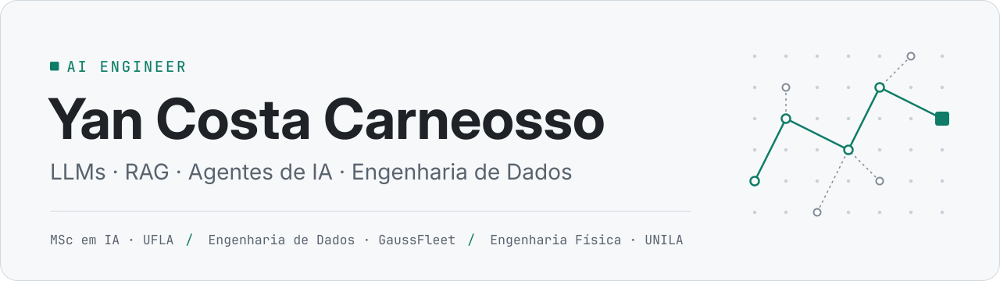
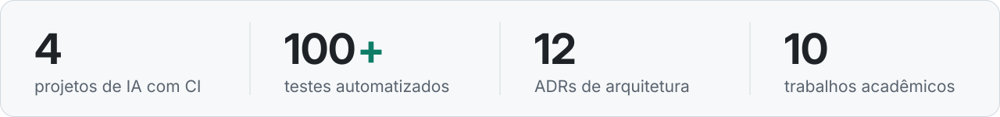
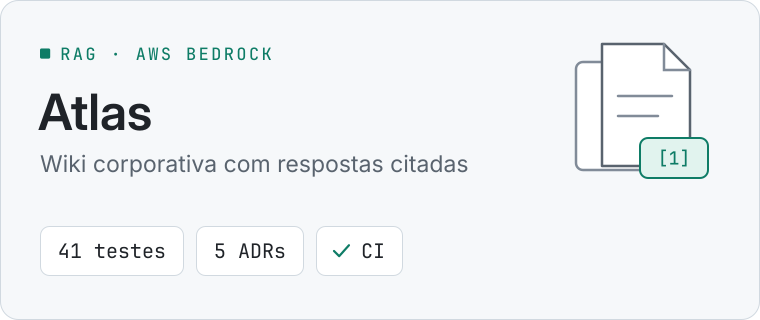
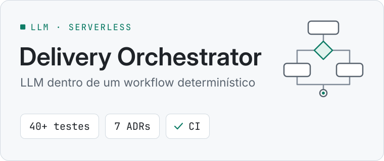
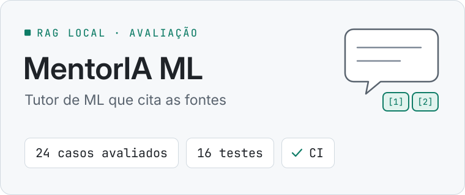
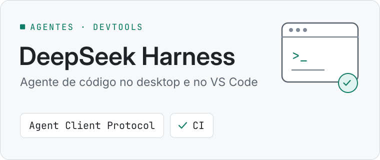

<!--
  README DO PERFIL — YanCarneosso
  Posicionamento: AI Engineer (LLMs, RAG, agentes, avaliação e operação).
  Imagens: geradas por identidade-visual/generate.py, com versões clara e escura.
  Guia de manutenção: PROFILE_CONFIG.md
-->

<picture>
  <source media="(prefers-color-scheme: dark)" srcset="./assets/brand/header-dark.svg">
  
</picture>

  <a href="https://www.linkedin.com/in/yan-costa-carneosso-b1343721b/"><strong>LinkedIn</strong></a>
  &nbsp;·&nbsp;
  <a href="mailto:yancarneosso@gmail.com"><strong>E-mail</strong></a>
  &nbsp;·&nbsp;
  <a href="#projetos-em-destaque"><strong>Projetos</strong></a>
  &nbsp;·&nbsp;
  <a href="#publicações-acadêmicas"><strong>Publicações</strong></a>
  <!-- ORCID e Lattes: adicionar aqui quando houver URL pública. -->

## Sobre

**AI Engineer** com formação em Engenharia Física e mestrado em andamento em Inteligência Artificial. Desenvolvo aplicações de IA generativa, como sistemas RAG, agentes e workflows com LLMs, com foco em confiabilidade: respostas rastreáveis, avaliação orientada por métricas, segurança e infraestrutura como código.

Atuo em Engenharia de Dados na **GaussFleet**, com pipelines, integrações, APIs e indicadores em Python, SQL e Power BI. Em paralelo, curso o **Mestrado em Engenharia de Sistemas e Automação na UFLA**, onde integro o grupo de pesquisa em Inteligência Artificial e Automação (AIA) e pesquiso agentes de IA e aprendizado de máquina para apoio a decisões jurídico-administrativas. Também participo do **University Mentoring Program (B4U) da Bayer**.

<picture>
  <source media="(prefers-color-scheme: dark)" srcset="./assets/brand/metrics-dark.svg">
  
</picture>

## Projetos em destaque

<!-- PROJETOS: capas geradas por identidade-visual/generate.py. Mantenha número par de cards. -->
<table>
  <tr>
    <td width="50%" valign="top">
      <a href="https://github.com/YanCarneosso/aws-intelligent-corporate-wiki">
        <picture>
          <source media="(prefers-color-scheme: dark)" srcset="./assets/projects/atlas-dark.svg">
          
        </picture>
      </a>
      
Plataforma RAG que transforma PDFs, documentos escaneados e dados de CRM em conhecimento pesquisável. Cada resposta cita a fonte (página do PDF ou linha do CSV) e, sem evidência suficiente, o sistema se abstém.

      
Python · TypeScript · React · Amazon Bedrock · Textract · Step Functions · AWS CDK

      
<a href="https://github.com/YanCarneosso/aws-intelligent-corporate-wiki"><strong>Ver projeto →</strong></a>

    </td>
    <td width="50%" valign="top">
      <a href="https://github.com/YanCarneosso/intelligent-delivery-orchestrator">
        <picture>
          <source media="(prefers-color-scheme: dark)" srcset="./assets/projects/delivery-orchestrator-dark.svg">
          
        </picture>
      </a>
      
Orquestração serverless de pedidos com IA generativa: o LLM interpreta pedidos em linguagem natural, enquanto pagamento, idempotência e auditoria permanecem determinísticos. Inclui defesa contra <em>prompt injection</em> e demo local sem conta AWS.

      
Python · AWS SAM · Step Functions · Amazon Bedrock · DynamoDB · CloudWatch

      
<a href="https://github.com/YanCarneosso/intelligent-delivery-orchestrator"><strong>Ver projeto →</strong></a>

    </td>
  </tr>
  <tr>
    <td width="50%" valign="top">
      <a href="https://github.com/YanCarneosso/mentoria-ml">
        <picture>
          <source media="(prefers-color-scheme: dark)" srcset="./assets/projects/mentoria-ml-dark.svg">
          
        </picture>
      </a>
      
Tutor de Machine Learning com RAG local, que adapta a explicação ao nível do estudante e mostra as fontes. Na avaliação com 24 casos, atingiu 100% de recuperação das fontes esperadas e de recusas corretas.

      
Python · Streamlit · Ollama · scikit-learn · pydantic

      
<a href="https://github.com/YanCarneosso/mentoria-ml"><strong>Ver projeto →</strong></a>

    </td>
    <td width="50%" valign="top">
      <a href="https://github.com/YanCarneosso/deepseek-harness-desktop">
        <picture>
          <source media="(prefers-color-scheme: dark)" srcset="./assets/projects/deepseek-harness-dark.svg">
          
        </picture>
      </a>
      
Integração desktop não oficial de um agente de programação para Linux: janela de aplicativo própria e chat no VS Code via Agent Client Protocol, com chamadas de ferramentas, diffs e pedidos de permissão.

      
JavaScript · Node.js · Bash · VS Code Extension API

      
<a href="https://github.com/YanCarneosso/deepseek-harness-desktop"><strong>Ver projeto →</strong></a>

    </td>
  </tr>
</table>

### Mais projetos

| Projeto | Descrição | Stack |
|---|---|---|
| [**Detecção de Fraudes com ML**](https://github.com/YanCarneosso/fraud-detection-ml) | ML de ponta a ponta em dados extremamente desbalanceados: recall de 85% e PR-AUC de 0,84 no teste, threshold escolhido por custo de negócio e explicabilidade com SHAP · [relatório executivo](https://yancarneosso.github.io/fraud-detection-ml/) | scikit-learn · XGBoost · SHAP |
| [**Análise de Feedbacks com IA**](https://github.com/YanCarneosso/desafio-dio-analise-feedbacks-ia) | Prompt reutilizável que transforma feedbacks de estudantes em indicadores, prioridades e ações, com regras contra alucinação e revisão humana obrigatória | Engenharia de prompts |
| [**Desenvolvimento de Modelos de ML**](https://github.com/YanCarneosso/caderno-desenvolvimento-modelos-machine-learning) | Caderno de estudo sobre o ciclo de vida de modelos de ML, construído a partir de 20 artigos científicos, com experimentos auditáveis | NotebookLM · Jupyter |
| **Vault Mind** · *em desenvolvimento* | Agente cognitivo local que registra conversas, indexa notas e recupera contexto por uma API de memória persistente | Python · FastAPI · Ollama · LanceDB |

## Como construo sistemas de IA

| Princípio | Na prática | Onde ver |
|---|---|---|
| **Respostas fundamentadas** | RAG que cita a fonte de cada resposta e se abstém quando não há evidência suficiente | [Atlas](https://github.com/YanCarneosso/aws-intelligent-corporate-wiki) · [MentorIA](https://github.com/YanCarneosso/mentoria-ml) |
| **LLM dentro de limites** | O modelo interpreta linguagem natural; pagamento, idempotência e regras críticas ficam em código determinístico | [Delivery Orchestrator](https://github.com/YanCarneosso/intelligent-delivery-orchestrator) |
| **Avaliação com métricas** | Conjuntos de avaliação para recuperação de fontes e recusas corretas; modelos e thresholds escolhidos por custo de negócio | [MentorIA](https://github.com/YanCarneosso/mentoria-ml) · [Detecção de Fraudes](https://github.com/YanCarneosso/fraud-detection-ml) |
| **Segurança desde o início** | Guardrails, contratos JSON Schema, defesa contra *prompt injection* e modelos de ameaças | [Atlas](https://github.com/YanCarneosso/aws-intelligent-corporate-wiki) · [Delivery Orchestrator](https://github.com/YanCarneosso/intelligent-delivery-orchestrator) |
| **Engenharia para operação** | Infraestrutura como código, CI, observabilidade, ADRs, runbooks e modelos de custo | [Atlas](https://github.com/YanCarneosso/aws-intelligent-corporate-wiki) · [Delivery Orchestrator](https://github.com/YanCarneosso/intelligent-delivery-orchestrator) |

## Competências

| Área | O que faço | Ferramentas |
|---|---|---|
| **LLMs e IA generativa** | Integração de modelos, engenharia de prompts, saídas estruturadas e LLMs locais | Amazon Bedrock (Nova) · Ollama · JSON Schema · pydantic |
| **RAG** | Ingestão de documentos e OCR, indexação vetorial, recuperação, citação de fontes e avaliação | Bedrock Knowledge Bases · S3 Vectors · Textract · LanceDB · TF-IDF |
| **Agentes de IA** | LLMs em workflows determinísticos, sistemas multiagentes e integração de agentes com ferramentas | Step Functions · Agent Client Protocol · FastAPI |
| **Segurança e avaliação** | Guardrails, defesa contra *prompt injection*, modelagem de ameaças e conjuntos de avaliação | Bedrock Guardrails · pytest |
| **Machine Learning** | Classificação com dados desbalanceados, seleção de modelos por custo e explicabilidade | scikit-learn · imbalanced-learn · XGBoost · SHAP · pandas · NumPy |
| **Cloud e operação (AWS)** | Arquitetura serverless, infraestrutura como código, observabilidade e CI | Lambda · DynamoDB · S3 · Cognito · CDK · SAM · CloudWatch · GitHub Actions |
| **Engenharia de dados** | Pipelines, ETL, integração via APIs, qualidade de dados e BI | Python · PHP · SQL · SQL Server · Power BI · DAX |
| **Engenharia de software** | Testes automatizados, tipagem estática, ADRs e documentação | pytest · ruff · mypy · TypeScript · React · Docker · Git · Linux |

## Pesquisa e publicações

Minha pesquisa atual é em IA aplicada: agentes, modelos de linguagem e aprendizado de máquina para apoio à decisão. Antes, pesquisei otimização, finanças descentralizadas e hidrogênio verde.

| Linha de pesquisa | Contexto | Produção |
|---|---|---|
| **IA aplicada ao direito administrativo:** classificação de documentos e agentes de apoio à decisão | Mestrado · UFLA · em andamento | 2 trabalhos no XXXV CPG (2026) |
| **LLMs e agent skills:** efeito de *skills* na geração de esquemáticos CircuitikZ por modelos de linguagem | UFLA · 2026 | 1 trabalho no XXXV CPG (2026) |
| **Otimização:** ajuste de parâmetros de controladores PI por algoritmo PSO | UFLA · 2026 | 1 trabalho no XXXV CPG (2026) |
| **Finanças descentralizadas:** análise quantitativa, backtesting e automação de operações em DeFi | TCC · UNILA · 2025 | [Trabalho completo](https://dspace.unila.edu.br/items/07b3d683-3e43-4344-8d5b-bfdb95f52402) |
| **Hidrogênio verde:** ligas metálicas comerciais como eletrocatalisadores, alternativa à platina | Iniciação científica · UNILA · 2022–2023 | Menção honrosa · [pôster](https://eicm.cure.edu.uy/home/evento-2023/presentacion-posters/) |

### Publicações acadêmicas

<!-- PUBLICAÇÕES: formato — **Título.** *Evento*, data. `Área` · [Acessar](URL). Adicione coautores e DOI quando houver. -->

**2026**

- **Aprendizado de máquina no apoio à seleção de instrumentos jurídico-administrativos.** *XXXV CPG – UFLA*, nov. 2026. `Machine Learning` `Direito administrativo`
- **Agente de apoio à tomada de decisão em atos e processos disciplinados pelo Regime Jurídico Único dos Servidores Públicos, Lei nº 8.112.** *XXXV CPG – UFLA*, nov. 2026. `Agentes de IA` `Direito administrativo`
- **Efeito de agent skills na geração de esquemáticos CircuitikZ por modelos de linguagem.** *XXXV CPG – UFLA*, nov. 2026. `LLMs` `Agent skills`
- **Otimização dos parâmetros PI de um controlador com desacoplamento aplicado ao conversor VR-BESS por algoritmo PSO.** *XXXV CPG – UFLA*, nov. 2026. `Otimização` `Sistemas de controle`
- **Descentralização da confiança e transformação da infraestrutura financeira: uma revisão sobre blockchain, contratos inteligentes e DeFi.** *XXXV CPG – UFLA*, nov. 2026. `Blockchain` `DeFi`

**2025**

- **Automação financeira em finanças descentralizadas (DeFi): análise quantitativa de séries financeiras e sistema de automação financeira em operações com criptomoedas.** *Repositório Institucional da UNILA*, dez. 2025. `DeFi` `Séries temporais` · [Acessar](https://dspace.unila.edu.br/items/07b3d683-3e43-4344-8d5b-bfdb95f52402)
- **MiniOficina de utilização da plataforma Arduino no Colégio Estadual do Campo Alberto Santos Dumont.** *EICITI 2025 – UNILA*, nov. 2025. `Educação científica` · [Anais da SIEPE 2025](https://portal.unila.edu.br/eventos/siepe-2025/anais)
- **Engenharia Física na Escola.** *43º Seminário de Extensão Universitária da Região Sul (SEURS)*, jul. 2025. `Extensão` · [Acessar](https://repositorio.udesc.br/bitstreams/cfbcd466-b7a0-4118-90db-9bcbe9054151/download)
- **Divulgação científica e feira de ciências nas escolas: mostra de trabalhos no município de Ramilândia.** *43º Seminário de Extensão Universitária da Região Sul (SEURS)*, jul. 2025. `Extensão` · [Acessar](https://repositorio.udesc.br/entities/publication/d162221d-4a5c-488b-8dd4-a0efb60b3d96)

**2023**

- **Ligas metálicas comerciais como eletrocatalisadores para a produção de gás hidrogênio em meio líquido iônico.** *II Encuentro de Investigadores en Ciencia de Materiales*, Uruguai, abr. 2023. `Eletroquímica` `Hidrogênio verde` · [Acessar](https://eicm.cure.edu.uy/home/evento-2023/presentacion-posters/)

## Trajetória

### Experiência

| Período | Função | Organização |
|---|---|---|
| jun. 2026 – atual | **Engenharia de Dados** (estágio): pipelines, APIs, SQL, Power BI e qualidade de dados | GaussFleet |
| abr. 2026 – atual | **Mentee** — University Mentoring Program (B4U) | Bayer |
| fev. 2025 – dez. 2025 | **Bolsista de extensão**: divulgação científica em Ramilândia, PR, com alcance de 67% dos colégios do município | UNILA |
| jan. 2024 – jan. 2025 | **Bolsista de extensão**: projeto Engenharia Física na Escola | UNILA |
| dez. 2023 – jun. 2024 | **Divisão Hidrogênio** — Grupo Cataratas de Eficiência Energética (GCEE) | Unioeste |
| fev. 2023 – dez. 2023 | **Professor de Matemática** (ensinos fundamental e médio) | Colégio Estadual Cívico-Militar Ipê Roxo |
| mai. 2022 – nov. 2023 | **Bolsista de iniciação científica**: eletrocatálise para produção de hidrogênio | UNILA |
| jul. 2022 – fev. 2026 | **Representação acadêmica**: Conselho do ILACVN, diretoria do CAENFIS e Comissão Superior de Extensão (COSUEX) | UNILA |

### Formação

| Período | Curso | Instituição |
|---|---|---|
| mar. 2026 – dez. 2027 (previsão) | **Mestrado em Engenharia de Sistemas e Automação**, ênfase em IA · grupo de pesquisa AIA | UFLA |
| mar. 2020 – dez. 2025 | **Bacharelado em Engenharia Física** | UNILA |

**Idiomas:** português, espanhol e inglês (em desenvolvimento).

## Certificações e reconhecimentos

<table>
  <tr>
    <th width="50%" align="left">Certificações</th>
    <th width="50%" align="left">Reconhecimentos</th>
  </tr>
  <tr>
    <td valign="top">
      <ul>
        <li><strong>AWS — AI Agents</strong> · DIO · 2026</li>
        <li><strong>Bootcamp Bradesco — GenAI, Dados &amp; Cyber</strong> · DIO · 2026</li>
        <li><strong>Inteligência Artificial: Estratégias para Educação e Indústria</strong> · SENAI-SP · 2026</li>
        <li><strong>Scrum Fundamentals Certified (SFC™)</strong> · SCRUMstudy · 2026</li>
        <li><strong>Business Analysis Fundamentals Certified (BAFC™)</strong> · VMEdu · 2026</li>
        <li><strong>Six Sigma Yellow Belt</strong> · 6sigmastudy · 2026</li>
        <li><strong>Six Sigma White Belt</strong> · Council for Six Sigma Certification · 2026</li>
      </ul>
    </td>
    <td valign="top">
      <ul>
        <li><strong>Menção Honrosa de Extensão Universitária</strong> (bolsista CNPq) · 7ª SIEPE, UNILA · 2025</li>
        <li><strong>Menção Honrosa de Iniciação Científica</strong> (bolsista Fundação Araucária) · 3ª SIEPE, UNILA · 2022</li>
        <li><strong>Shell Eco-marathon 2024</strong> · veículo da equipe GCEE selecionado entre os seis melhores em design</li>
      </ul>
    </td>
  </tr>
</table>

---

  
    Interessado em AI Engineering: LLMs, RAG, agentes e avaliação de modelos. 
    <a href="https://www.linkedin.com/in/yan-costa-carneosso-b1343721b/">LinkedIn</a> · <a href="mailto:yancarneosso@gmail.com">E-mail</a> · Atualizado em novembro de 2026
  

